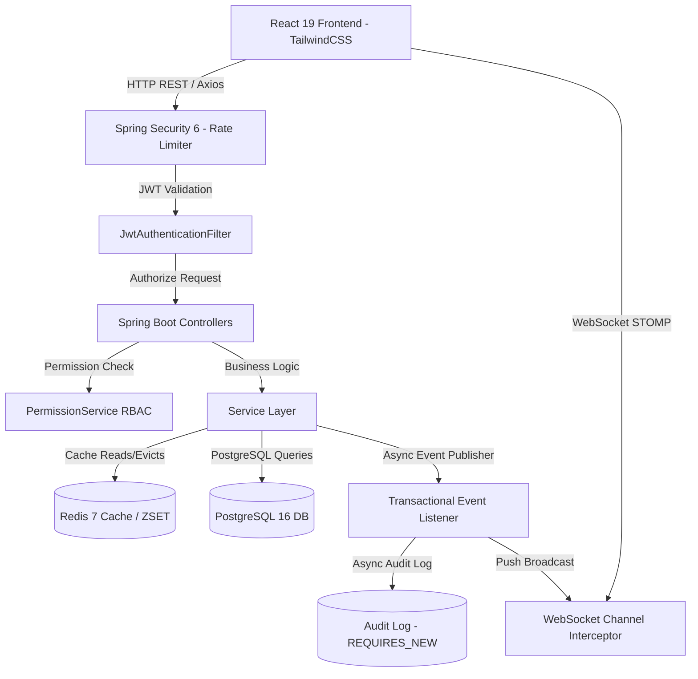
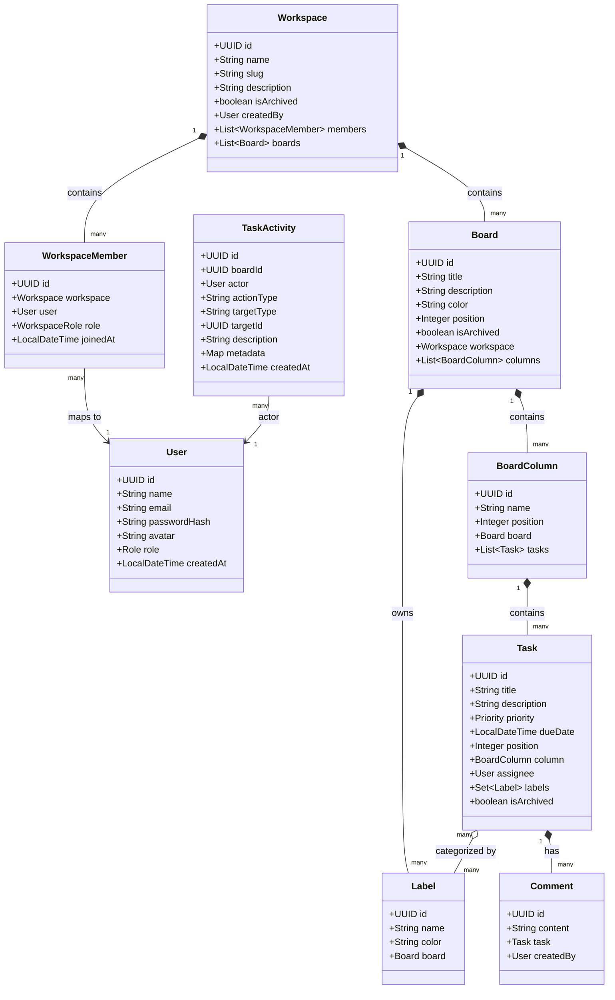
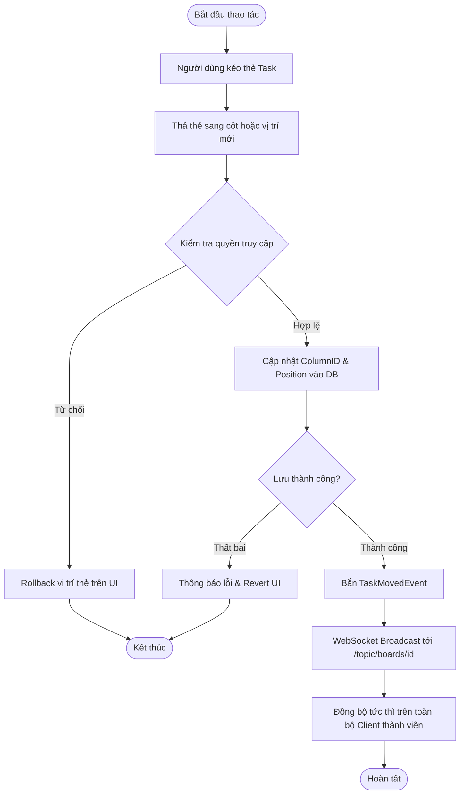

#  Fwork — Enterprise Real-time Kanban Collaboration Platform

[](./PROJECT_REPORT.md)
[](https://openjdk.org/projects/jdk/21/)
[](https://spring.io/projects/spring-boot)
[](https://react.dev/)
[](https://vitejs.dev/)
[](https://www.postgresql.org/)
[](https://redis.io/)

**Fwork** là hệ thống Kanban cộng tác thời gian thực cho doanh nghiệp, xây dựng trên kiến trúc **Spring Boot 4.1 + Java 21** và **React 19 + Vite 8**. Hệ thống tập trung giải quyết các bài toán cốt lõi: đồng bộ dữ liệu tức thì không trễ (STOMP WebSocket), kiểm soát phân quyền chặt chẽ (RBAC), tối ưu truy vấn cơ sở dữ liệu (chống N+1, hai tầng cache Redis), chịu tải bằng thuật toán Sliding Window Rate Limiting và hỗ trợ tự động hóa luồng việc với Google Gemini AI.

---

##  Mục lục

1. [Tổng quan kiến trúc & Điểm nhấn kỹ thuật](#-tổng-quan-kiến-trúc--điểm-nhấn-kỹ-thuật)
2. [Tính năng hệ thống](#-tính-năng-hệ-thống)
3. [Tech Stack & Lựa chọn công nghệ](#-tech-stack--lựa-chọn-công-nghệ)
4. [Kiến trúc hệ thống & Sơ đồ UML](#-kiến-trúc-hệ-thống--sơ-đồ-uml)
5. [Cấu trúc thư mục](#-cấu-trúc-thư-mục)
6. [Thiết lập môi trường (.env)](#-thiết-lập-môi-trường-env)
7. [Hướng dẫn khởi chạy (Local & Docker)](#-hướng-dẫn-khởi-chạy)
8. [API Documentation & Swagger](#-api-documentation--swagger)
9. [Kiểm thử & Đảm bảo chất lượng (Test Suites)](#-kiểm-thử--đảm-bảo-chất-lượng)

---

##  Tổng quan kiến trúc & Điểm nhấn kỹ thuật

Thay vì triển khai theo lối CRUD thông thường, Fwork được thiết kế theo tiêu chuẩn production của các nền tảng SaaS hiện đại:

- **State Sync & Real-time via STOMP Broker**: Thay vì polling liên tục, mọi thay đổi trên Kanban board (move task, update priority, assign, add label, comment) được broadcast qua channel `/topic/boards/{boardId}` với payload định danh rõ ràng. Kết hợp WebSocket Channel Interceptor để validate JWT token ngay tại frame `CONNECT` và check quyền Workspace khi `SUBSCRIBE`.
- **Database Query Tuning & Zero N+1**: Sử dụng dynamic `@EntityGraph` và batch GROUP BY queries cho các liên kết phân cấp (`Workspace` ➔ `Board` ➔ `Column` ➔ `Task`), loại bỏ hoàn toàn bẫy N+1 query thường gặp trong JPA. Cột `metadata` dạng JSONB kèm index tối ưu cho activity log.
- **Distributed Rate Limiting (Sliding Window)**: Triển khai thuật toán Sliding Window Counter bằng Redis `ZSET`, tự động ngắt tải khi client vượt ngưỡng (HTTP 429) và trang bị cơ chế fallback sang In-Memory Concurrent HashMap khi cụm Redis gặp sự cố.
- **Fail-safe Audit Logging**: Ghi nhận toàn bộ hành động nhạy cảm (phân quyền, chuyển giao quyền sở hữu Workspace, mời thành viên) với `Propagation.REQUIRES_NEW`, đảm bảo log kiểm toán luôn được lưu độc lập dù nghiệp vụ chính thành công hay rollback.
- **Two-tier Caching Layer**: Bộ đệm Redis kết hợp Spring Cache cho Workspace, Board và Metrics, giúp giảm tới 80% áp lực đọc trực tiếp từ PostgreSQL.

---

##  Tính năng hệ thống

### 1. Kanban Engine & Tương tác kéo thả
- Phân cấp quản lý đa tầng: `Workspace` ➔ `Board` ➔ `Column` ➔ `Task` ➔ `Checklist / Comment / Label`.
- Kéo thả thẻ và sắp xếp vị trí cột mượt mà với `@dnd-kit/core` và `@dnd-kit/sortable`.
- Logic thông minh: Tự động chuyển thẻ vào cột Hoàn thành khi check hoàn tất và khôi phục vị trí cũ khi bỏ tick.

### 2. Đồng bộ thời gian thực (Real-time Broadcast)
- Broadcast tức thì mọi cập nhật bảng công việc qua WebSocket.
- Người dùng cùng board nhận được update ngay lập tức mà không cần F5/tải lại trang.

### 3. Trợ lý lập kế hoạch bằng AI (Gemini AI)
- Tích hợp Spring AI với Google Gemini:
  - Tự động sinh danh sách công việc (`Generate tasks`) từ mô tả mục tiêu dự án.
  - Phân rã nhiệm vụ phức tạp (`AI Breakdown`) thành các checklist nhỏ gọn với độ ưu tiên logic.

### 4. Kiểm soát phân quyền tập trung (RBAC & Security)
- Ma trận phân quyền 3 cấp độ: `OWNER`, `ADMIN`, `MEMBER` quản lý qua `PermissionService`.
- Token mời vào Workspace được băm **SHA-256**, tự động vô hiệu hóa sau 7 ngày hoặc khi đã chấp thuận.
- Tự động bảo vệ trước các hành vi leo quyền (phòng chống IDOR, kiểm tra quyền sở hữu trước mỗi transaction).

### 5. Activity Tracking & Metrics
- Lưu lại nhật ký thay đổi chi tiết: ai đã đổi trạng thái thẻ nào, gán nhãn gì, bình luận lúc nào.
- Hỗ trợ xem phân trang activity log và xuất số liệu giám sát qua Micrometer Prometheus `/actuator`.

---

## Tech Stack & Lựa chọn công nghệ

| Thành phần | Công nghệ | Phiên bản | Ghi chú kiến trúc |
| :--- | :--- | :--- | :--- |
| **Backend Core** | Java, Spring Boot | 21 / 4.1.0 | Spring Security 6, Spring Data JPA |
| **Database** | PostgreSQL | 16 | Indexing `board_id`, `created_at`, lưu trữ JSONB |
| **Caching & Limiter** | Redis | 7 | Caching `@Cacheable`, Sliding Window Rate Limiting |
| **Real-time Protocol**| WebSocket + STOMP | — | SockJS Fallback, Channel Interceptor Security |
| **AI Integration** | Spring AI | 2.0.0 | Google Gemini SDK |
| **Frontend Core** | React, Vite | 19.2 / 8.0 | React Router v7, ES Modules |
| **Styling** | TailwindCSS | 4.3 | Custom Material Design 3 Palette & Glassmorphism |
| **Drag and Drop** | dnd-kit | 6.3 | Sensor abstraction, keyboard & touch accessibility |
| **API Client** | Axios | 1.17 | Interceptors xử lý tự động JWT Bearer & Refresh |

---

## Kiến trúc hệ thống & Sơ đồ UML

### 1. Kiến trúc phân tầng (High-Level Architecture)



### 2. Sơ đồ dữ liệu thực thể (Class Diagram)



### 3. Quy trình kéo thả & Broadcast thời gian thực (Activity Diagram)



---

## Cấu trúc thư mục

```text
Fwork/
├── backend/                         # Spring Boot Application
│   ├── src/main/java/com/intern/fwork/
│   │   ├── config/                  # Security, Redis, WebSocket, OpenAPI config
│   │   ├── controllers/             # REST API Controllers
│   │   ├── dtos/                    # Request & Response Contracts
│   │   ├── entities/                # JPA Domain Entities
│   │   ├── enums/                   # RBAC Roles, Priority definitions
│   │   ├── exceptions/              # Global REST Exception Handler
│   │   ├── ratelimit/               # Sliding Window Redis & In-Memory Fallback
│   │   ├── repositories/            # Spring Data Repositories & EntityGraphs
│   │   ├── security/                # JwtFilter, SecurityUtils, CustomUserDetails
│   │   └── services/                # Business & RBAC Services
│   └── src/test/java/               # 54 Integration & Security Matrix Tests
├── frontend/                        # React 19 Client SPA
│   ├── src/
│   │   ├── components/              # Board, Task, Layout, UI Primitives
│   │   ├── context/                 # Auth & Language Contexts
│   │   ├── hooks/                   # useBoard, useWorkspace Custom Hooks
│   │   ├── lib/                     # Axios Instance & STOMP Client
│   │   ├── pages/                   # Dashboard, Kanban Board, Settings, Login
│   │   └── index.css                # Material Design 3 Design Tokens
│   ├── index.html                   # HTML Entry
│   └── package.json
├── docker-compose.yml               # Multi-container orchestration (DB, Redis, App)
└── README.md
```

---

## Thiết lập môi trường (.env)

Tạo file `.env` tại thư mục gốc dự án:

```env
# DATABASE POSTGRESQL
DB_HOST=localhost
DB_PORT=5432
DB_NAME=Fwork
DB_USERNAME=postgres
DB_PASSWORD=postgres

# REDIS CACHE & RATE LIMITER
REDIS_HOST=localhost
REDIS_PORT=6379
REDIS_PASSWORD=

# JWT AUTHENTICATION
JWT_SECRET=B9KWlBRILyT59ftELaWsuZsXQb9/piaorNS/SuX4IMzgTFNphg7wVfzhfasqpWehb83ApfZee3gX1/UV1EMxoA==
JWT_EXPIRATION=900000
JWT_REFRESH_EXPIRATION=604800000

# GOOGLE GEMINI AI
GEMINI_API_KEY=your_gemini_api_key_here
```

---

## Hướng dẫn khởi chạy

### Phương án 1: Chạy bằng Docker Compose (Khuyên dùng)

Yêu cầu môi trường: **Docker Engine** và **Docker Compose**.

```bash
# 1. Clone source code
git clone https://github.com/Eddy-hoang/Fwork.git
cd Fwork

# 2. Khởi tạo môi trường
cp .env.example .env

# 3. Build và khởi chạy toàn bộ dịch vụ
docker compose up --build -d
```

Các endpoint sau khi hệ thống sẵn sàng:
- **Frontend App:** `http://localhost:3000`
- **Backend API:** `http://localhost:8080/api`
- **Swagger Documentation:** `http://localhost:8080/swagger-ui/index.html`
- **Actuator Health & Metrics:** `http://localhost:8080/actuator/health`

---

### Phương án 2: Khởi chạy thủ công từng phần (Development)

#### 1. Chạy PostgreSQL & Redis (Docker):
```bash
docker run --name fwork-postgres -e POSTGRES_DB=Fwork -e POSTGRES_PASSWORD=postgres -p 5432:5432 -d postgres:16
docker run --name fwork-redis -p 6379:6379 -d redis:7
```

#### 2. Khởi chạy Backend (Spring Boot):
```bash
cd backend
# Windows
.\mvnw.cmd spring-boot:run

# Linux / macOS
./mvnw spring-boot:run
```

#### 3. Khởi chạy Frontend (Vite):
```bash
cd frontend
npm install
npm run dev
```

---

## API Documentation & Swagger

Tài liệu API được sinh tự động chuẩn OpenAPI 3.0 tại:
`http://localhost:8080/swagger-ui/index.html`

### Danh sách Endpoint tiêu biểu:

| Phương thức | Đường dẫn | Chức năng | Phân quyền yêu cầu |
| :--- | :--- | :--- | :--- |
| `POST` | `/api/auth/register` | Đăng ký tài khoản | Public |
| `POST` | `/api/auth/login` | Đăng nhập & lấy Bearer JWT | Public |
| `GET` | `/api/workspaces` | Lấy danh sách Workspace của User | Authenticated |
| `POST` | `/api/workspaces/{id}/members` | Thêm thành viên vào Workspace | Admin / Owner |
| `GET` | `/api/boards/{id}` | Lấy chi tiết Board, Cột & Thẻ công việc | Workspace Member |
| `PATCH`| `/api/tasks/{id}/move` | Kéo thả di chuyển trạng thái Task | Workspace Member |
| `POST` | `/api/boards/{id}/ai/generate-tasks` | Sinh task tự động qua Gemini AI | Workspace Member |
| `GET` | `/api/boards/{id}/activities` | Xem lịch sử hoạt động (phân trang) | Workspace Member |

---

## Kiểm thử & Đảm bảo chất lượng (Test Suites)

Hệ thống được bảo vệ bởi **54 Automated Integration Tests** bao phủ các luồng nghiệp vụ cốt lõi:

```text
[INFO] Results:
[INFO] Tests run: 54, Failures: 0, Errors: 0, Skipped: 0
[INFO] ------------------------------------------------------------------------
[INFO] BUILD SUCCESS
[INFO] ------------------------------------------------------------------------
```

### Các kịch bản kiểm thử trọng điểm:
- **`SecurityMatrixIntegrationTest`**: Kiểm thử ma trận phân quyền 3 cấp (Owner, Admin, Member), chặn triệt để hành vi leo quyền IDOR.
- **`TaskPaginationIntegrationTest`**: Đo đếm số lượng câu truy vấn Hibernate, kiểm tra dứt điểm lỗi N+1 query.
- **`CacheIntegrationTest`**: Xác thực tính đúng đắn của chu kỳ cache `@Cacheable` và dọn dẹp cache `@CacheEvict`.
- **`RateLimitIntegrationTest`**: Kiểm thử giới hạn tần suất gửi request, chặn spam và tấn công từ chối dịch vụ.
- **`KanbanEndToEndIntegrationTest`**: Kiểm thử toàn bộ vòng đời của một Task từ khởi tạo ➔ kéo thả chuyển cột ➔ hoàn thành ➔ lưu vết audit log.

---
*Tài liệu kỹ thuật nội bộ Fwork — Maintainer: Eddy Hoang*
