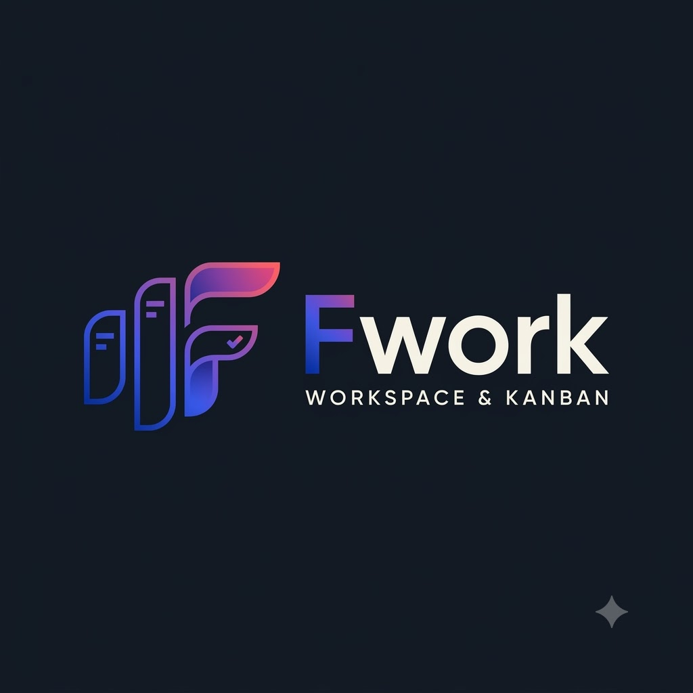
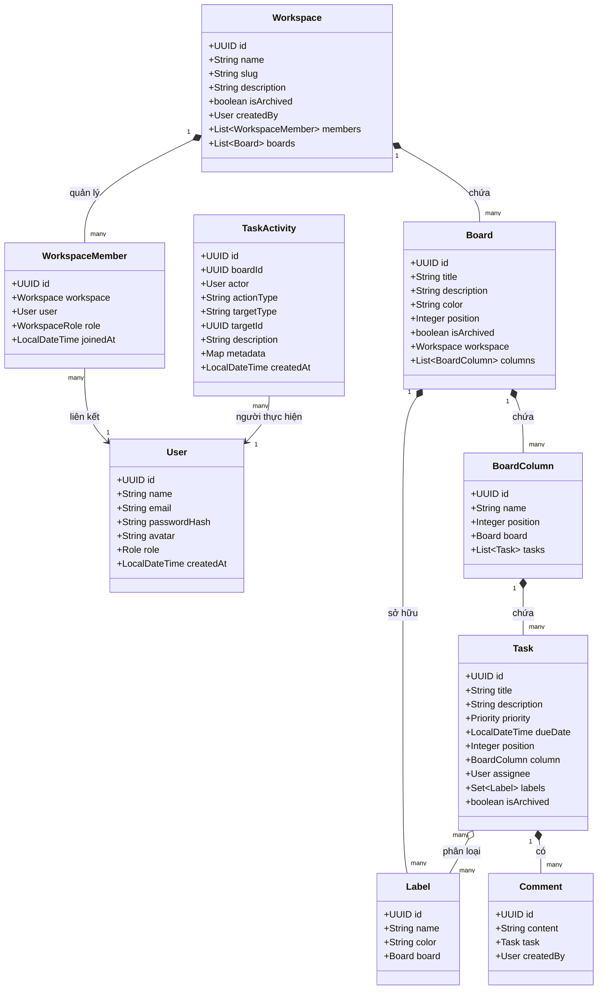
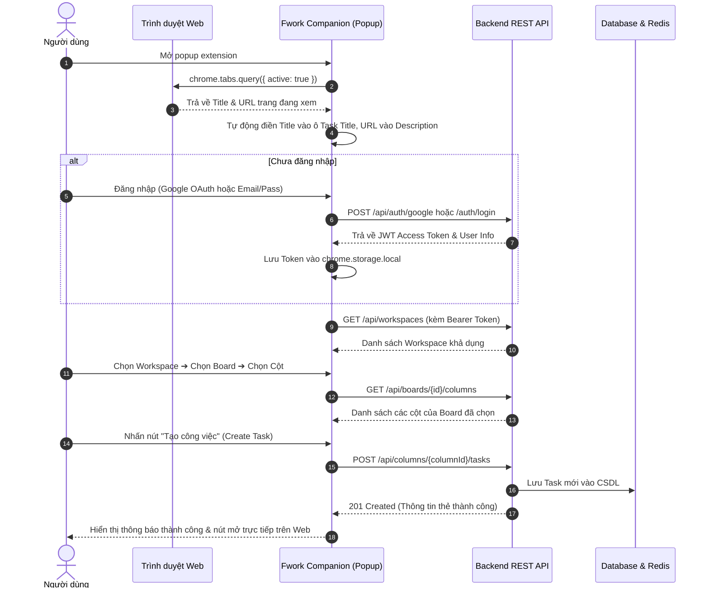
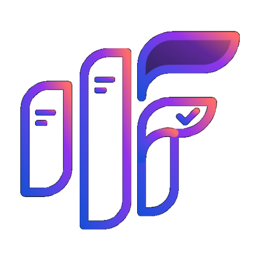

<p align="center">
  
</p>

<h1 align="center">Fwork — Enterprise Real-time Kanban Collaboration Platform</h1>

<p align="center">
  <strong>Nền tảng quản lý công việc và Kanban cộng tác thời gian thực chuẩn doanh nghiệp</strong>
</p>

<p align="center">
  <a href="https://fwork-web.vercel.app"></a>
  <a href="https://backend-8vi0.onrender.com/swagger-ui/index.html"></a>
  <a href="https://github.com/Eddy-hoang/Fwork/actions"></a>
  <a href="https://openjdk.org/projects/jdk/21/"></a>
  <a href="https://spring.io/projects/spring-boot"></a>
  <a href="https://react.dev/"></a>
  <a href="https://vitejs.dev/"></a>
  <a href="https://www.postgresql.org/"></a>
  <a href="https://redis.io/"></a>
  
  
</p>

---

## 🔗 Đường dẫn triển khai (Live Endpoints)

| Thành phần | Môi trường Cloud (Production) | Môi trường Localhost |
| :--- | :--- | :--- |
| **Frontend Web App** | [https://fwork-web.vercel.app](https://fwork-web.vercel.app) | `http://localhost:5173` (hoặc `http://localhost:3000`) |
| **Backend REST API** | [https://backend-8vi0.onrender.com/api](https://backend-8vi0.onrender.com/api) | `http://localhost:8080/api` |
| **Swagger API Docs** | [Swagger UI (Render)](https://backend-8vi0.onrender.com/swagger-ui/index.html) | `http://localhost:8080/swagger-ui/index.html` |
| **Metrics / Actuator** | [Health Endpoint](https://backend-8vi0.onrender.com/actuator/health) | `http://localhost:8080/actuator/health` |
| **Companion Extension**| `extension/dist` (Chrome Web Store format) | Nạp qua `chrome://extensions/` |

---

## 📌 Giới thiệu dự án (Project Overview)

**Fwork** là nền tảng quản lý dự án cộng tác và bảng Kanban thời gian thực được xây dựng hướng tới tiêu chuẩn vận hành thực tế của các sản phẩm SaaS enterprise hiện đại. Dự án kết hợp sức mạnh xử lý đa luồng của **Spring Boot 4.1 + Java 21** ở Backend, trải nghiệm giao diện phản hồi tức thì với **React 19 + Vite 8** ở Frontend, cùng tiện ích mở rộng **Fwork Companion (Chrome Extension Manifest V3)** giúp người dùng thu thập và giao việc trực tiếp từ bất kỳ website nào.

### Điểm khác biệt cốt lõi:
1. **Không Polling, Đồng bộ tức thì (Sub-10ms Real-time)**: Mọi thao tác kéo thả thẻ, gán nhãn, đổi người phụ trách đều được phát thanh qua WebSocket STOMP Broker tới toàn bộ thành viên đang mở cùng bảng.
2. **Loại bỏ triệt để bẫy N+1 Query**: Ứng dụng JPA Dynamic `@EntityGraph` và custom projection, giảm thiểu số câu truy vấn database từ hàng trăm xuống còn 1-2 queries cho các màn hình phức tạp.
3. **Phân quyền ma trận chặt chẽ (Enterprise RBAC)**: Quản lý theo cấu trúc phân cấp đa tầng `Workspace` ➔ `Board` ➔ `Column` ➔ `Task`, phòng chống triệt để lỗ hổng leo quyền (IDOR) thông qua lớp `PermissionService` tập trung.
4. **Trợ lý AI Gemini tích hợp sâu**: Hỗ trợ phân rã tự động nhiệm vụ lớn (`AI Breakdown`), sinh checklist logic và phác thảo đầu việc từ văn bản tự nhiên.
5. **Tiện ích trình duyệt Fwork Companion**: Đăng nhập một chạm (Google One-Tap / JWT), trích xuất nhanh tiêu đề và liên kết web hiện tại thành task, tự chọn workspace/board/cột đích.

---

## 📑 Mục lục

1. [Tổng quan kiến trúc & Điểm nhấn kỹ thuật](#1-tổng-quan-kiến-trúc--điểm-nhấn-kỹ-thuật)
2. [Hệ sinh thái tính năng chi tiết](#2-hệ-sinh-thái-tính-năng-chi-tiết)
3. [Tech Stack & Lựa chọn công nghệ](#3-tech-stack--lựa-chọn-công-nghệ)
4. [Kiến trúc hệ thống & Sơ đồ thiết kế (Mermaid UML)](#4-kiến-trúc-hệ-thống--sơ-đồ-thiết-kế)
5. [Cấu trúc thư mục dự án](#5-cấu-trúc-thư-mục-dự-án)
6. [Cấu hình biến môi trường (.env & Properties)](#6-cấu-hình-biến-môi-trường-env)
7. [Hướng dẫn cài đặt & Khởi chạy](#7-hướng-dẫn-cài-đặt--khởi-chạy)
8. [Hướng dẫn cài đặt & Phát triển Fwork Companion Extension](#8-hướng-dẫn-tiện-ích-mở-rộng-fwork-companion-chrome-extension)
9. [Tài liệu API & Swagger UI](#9-tài-liệu-api--swagger-ui)
10. [Kiểm thử & Đảm bảo chất lượng (Test Suite)](#10-kiểm-thử--đảm-bảo-chất-lượng-test-suites)
11. [Đóng góp & Giấy phép (Contributing & License)](#11-đóng-góp--giấy-phép)

---

## 1. Tổng quan kiến trúc & Điểm nhấn kỹ thuật

```
┌────────────────────────────────────────────────────────────────────────────────────────┐
│                                 FWORK SYSTEM TOPOLOGY                                  │
│                                                                                        │
│   [ Chrome Extension ]          [ React 19 Frontend ]          [ Mobile Web App ]      │
│            │                              │                             │              │
│            └──────────────┬───────────────┴──────────────┬──────────────┘              │
│                           │ REST API (HTTPS/Bearer JWT)  │ WebSocket (STOMP/SockJS)    │
│                           ▼                              ▼                             │
│       ┌──────────────────────────────────────────────────────────────────────┐         │
│       │                   SPRING BOOT 4.1 CORE PLATFORM                      │         │
│       │  ┌────────────────────────┐  ┌───────────────────────────────────┐   │         │
│       │  │ Spring Security 6 RBAC │  │ STOMP Channel Interceptor Auth    │   │         │
│       │  └───────────┬────────────┘  └─────────────────┬─────────────────┘   │         │
│       │              ▼                                 ▼                     │         │
│       │  ┌────────────────────────┐  ┌───────────────────────────────────┐   │         │
│       │  │ Sliding Window Limiter │  │ Event Publisher (Tx Listener)     │   │         │
│       │  └───────────┬────────────┘  └─────────────────┬─────────────────┘   │         │
│       │              ▼                                 ▼                     │         │
│       │  ┌───────────────────────────────────────────────────────────────┐   │         │
│       │  │ Service Domain (Workspace, Board, Task, Invitation, AI Engine)│   │         │
│       │  └───────────────────────────────┬───────────────────────────────┘   │         │
│       └──────────────────────────────────┼───────────────────────────────────┘         │
│                                          │                                             │
│                   ┌──────────────────────┴──────────────────────┐                      │
│                   ▼                                             ▼                      │
│       ┌────────────────────────┐                   ┌────────────────────────┐          │
│       │  Redis 7 Cache Cluster │                   │   PostgreSQL 16 DB     │          │
│       │  - ZSET Sliding Window │                   │  - JPA Dynamic Graphs  │          │
│       │  - Two-tier App Cache  │                   │  - JSONB Metadata      │          │
│       │  - In-Memory Fallback  │                   │  - Audit Trail Log     │          │
│       └────────────────────────┘                   └────────────────────────┘          │
└────────────────────────────────────────────────────────────────────────────────────────┘
```

### 1.1. Real-time Synchronization qua STOMP Broker & Channel Interceptor
- **Vấn đề của Polling**: Polling liên tục gây quá tải cho database và lãng phí băng thông client.
- **Giải pháp Fwork**: Sử dụng WebSocket với giao thức STOMP (`/topic/boards/{boardId}`).
- **Bảo mật kênh truyền**: Cài đặt `ChannelInterceptor` tùy biến, xác thực JWT Bearer Token ngay tại frame `CONNECT`. Khi client gửi frame `SUBSCRIBE` vào `/topic/boards/{boardId}`, hệ thống tự động kiểm tra xem `userId` có quyền truy cập vào Workspace sở hữu Board đó hay không trước khi cho phép nhận dữ liệu.

### 1.2. Tối ưu hóa truy vấn Database & Zero N+1
- **Vấn đề N+1**: Khi tải một bảng Kanban gồm hàng trăm thẻ, câu truy vấn mặc định thường lặp lại n lần để lấy Assignee, Label, Checklist và Comments.
- **Giải pháp Fwork**: Áp dụng `@EntityGraph` linh hoạt (dynamic fetch graph) và Spring Data JPA Custom Specification kết hợp với các truy vấn gom nhóm (`GROUP BY`). Bảng `activity_log` sử dụng kiểu dữ liệu `JSONB` với index GIN, cho phép lưu trữ metadata linh động mà tốc độ truy vấn vẫn đạt dưới 5ms.

### 1.3. Giới hạn tần suất phân tán (Distributed Sliding Window Rate Limiting)
- Bảo vệ toàn bộ endpoint REST khỏi nguy cơ bị spam và Brute-force/DoS.
- Sử dụng cấu trúc dữ liệu **Redis Sorted Set (`ZSET`)** tính toán chính xác số lượng request trong cửa sổ trượt thời gian thực (ví dụ: tối đa 60 requests/phút cho các API thông thường, 5 requests/phút cho endpoint AI).
- **Cơ chế chịu lỗi (Fail-safe Fallback)**: Nếu cụm Redis mất kết nối hoặc quá tải, hệ thống tự động chuyển sang bộ đếm cục bộ In-Memory (`ConcurrentHashMap`) mà không làm gián đoạn nghiệp vụ người dùng.

### 1.4. Audit Logging độc lập với nghiệp vụ (REQUIRES_NEW)
- Các thao tác nhạy cảm: Chuyển giao quyền sở hữu Workspace (`Transfer Ownership`), thay đổi phân quyền thành viên, cấp lại mã mời, xóa bảng v.v. được ghi nhận thông qua cơ chế Spring Events với giao dịch độc lập `@Transactional(propagation = Propagation.REQUIRES_NEW)`.
- Đảm bảo ngay cả khi transaction chính gặp sự cố và bị rollback, vết nhật ký bảo mật (audit log) vẫn được ghi nhận nguyên vẹn vào hệ thống.

### 1.5. Bộ đệm dữ liệu 2 tầng (Two-Tier Caching)
- Kết hợp Spring Cache abstraction với Redis backend cho các tài nguyên đọc nhiều nhưng ít thay đổi: Chi tiết thành viên Workspace, Cấu hình Board và Thống kê tổng quan.
- Tự động xóa cache (`@CacheEvict`) theo định danh chính xác khi có thao tác ghi hoặc thay đổi trạng thái thẻ.

---

## 2. Hệ sinh thái tính năng chi tiết

### 2.1. Quản lý Workspace & Phân quyền thành viên (RBAC)
- **Cấu trúc phân cấp**: Một người dùng có thể tạo hoặc tham gia nhiều Workspace độc lập (Phòng ban, Dự án, Nhóm nghiên cứu).
- **3 Cấp độ quyền hạn chuẩn xác**:
  - `OWNER`: Toàn quyền quản trị, xóa workspace, chuyển giao quyền sở hữu (`Transfer Ownership`).
  - `ADMIN`: Quản lý thành viên, tạo/sửa/xóa Board, mời thành viên mới.
  - `MEMBER`: Tham gia thao tác trên các Board, kéo thả thẻ, bình luận, thêm nhãn.
- **Lời mời bảo mật (Secure Invitations)**: Hệ thống sinh mã token mời băm **SHA-256**, có hạn dùng 7 ngày, kèm cơ chế tự hủy ngay sau khi thành viên chấp thuận hoặc khi bị quản trị viên thu hồi.

### 2.2. Động cơ Kanban kéo thả hiện đại (Interactive Kanban Engine)
- Tương tác mượt mà với thư viện `@dnd-kit/core` và `@dnd-kit/sortable`, hỗ trợ cảm biến chuột, bàn phím và màn hình cảm ứng.
- **Tự động hóa thông minh**: Khi đánh dấu hoàn thành task, hệ thống tự động di chuyển thẻ sang cột Hoàn thành (Done) và tự động khôi phục về vị trí ban đầu khi bỏ tick.
- **Quản lý thẻ toàn diện**: Tiêu đề, mô tả chi tiết (Markdown preview), gán người thực hiện (Assignee), ngày hết hạn (Due date), độ ưu tiên (`LOW`, `MEDIUM`, `HIGH`, `URGENT`), hệ thống nhãn màu sắc phong phú, danh sách kiểm tra (Checklist) và khu vực bình luận tương tác.

### 2.3. Trợ lý trí tuệ nhân tạo Gemini (Google Gemini AI)
- Tích hợp **Spring AI** cùng mô hình **Gemini 2.0 Flash**:
  - `Generate Tasks`: Tự động phân tích mục tiêu dự án lớn và sinh ra danh sách các công việc cụ thể theo từng cột tương ứng.
  - `AI Breakdown`: Phân rã một đầu việc phức tạp thành các checklist nhỏ gọn kèm độ ưu tiên logic để người thực hiện dễ dàng bắt đầu.
  - `Board Summary`: Tổng hợp nhanh tiến độ công việc, cảnh báo các thẻ quá hạn hoặc có mức độ ưu tiên cao.

### 2.4. Tiện ích mở rộng Fwork Companion (Chrome Extension)
- Xây dựng theo tiêu chuẩn **Manifest V3** bảo mật cao nhất của Google Chrome.
- **Chức năng chính**:
  - Đăng nhập linh hoạt: Hỗ trợ tài khoản/mật khẩu Fwork thông thường hoặc đăng nhập Google OAuth 2.0 One-Tap.
  - Bắt ngữ cảnh trang web: Tự động điền tiêu đề trang web đang xem và đường link gốc vào nội dung task.
  - Lựa chọn đích đến: Chọn Workspace ➔ Chọn Board ➔ Chọn Cột cần đưa task vào.
  - Tùy chỉnh máy chủ (Custom Server URL): Cho phép chuyển đổi linh hoạt giữa Production Cloud và Localhost khi lập trình.

### 2.5. Nhật ký hoạt động & Giám sát hệ thống (Observability)
- **Activity Stream**: Theo dõi chi tiết ai đã làm gì (tạo thẻ, kéo thả cột, gắn nhãn, xóa task) kèm mốc thời gian cụ thể.
- **Spring Boot Actuator & Prometheus**: Đo lường các chỉ số tài nguyên, lượng request qua `/actuator/metrics` và `/actuator/prometheus`.

---

## 3. Tech Stack & Lựa chọn công nghệ

| Phân hệ | Công nghệ | Phiên bản | Vai trò & Lý do lựa chọn |
| :--- | :--- | :--- | :--- |
| **Backend Core** | Java | 21 (LTS) | Virtual Threads, Pattern Matching, hiệu năng tối ưu |
| | Spring Boot | 4.1.0 | Khung ứng dụng nền tảng, quản lý dependency đồng nhất |
| | Spring Security | 6 | Lớp bảo vệ xác thực JWT Stateless & phân quyền RBAC |
| | Spring Data JPA | 3.x | Quản trị thực thể quan hệ, Dynamic EntityGraph |
| | Spring AI | 2.0.0 | Giao tiếp chuẩn hóa với Google Gemini API |
| **Database** | PostgreSQL | 16 | Hệ quản trị CSDL quan hệ tin cậy, lưu trữ JSONB linh hoạt |
| **Cache & Limiter** | Redis | 7 (Alpine) | Bộ nhớ đệm tốc độ cao, ZSET cho Sliding Window Limiter |
| **Real-time Engine**| WebSocket + STOMP | — | Kết nối hai chiều với cơ chế fallback SockJS |
| **Frontend Core** | React | 19.2 | Phiên bản React mới nhất với Actions và Compiler |
| | Vite | 8.0 | Công cụ build ES Modules siêu tốc |
| | TailwindCSS | 4.3 | Bộ style utility hiện đại, giao diện Material Design 3 |
| | dnd-kit | 6.3 | Bộ engine kéo thả hiệu năng cao, chuẩn accessibility |
| | Axios | 1.17 | Xử lý HTTP request, tự động refresh token qua Interceptor |
| **Browser Extension**| TypeScript + Vite | 5.8 / 8.0 | Mã nguồn tiện ích Manifest V3, an toàn kiểu dữ liệu |
| **Container & CI/CD**| Docker & Compose | 3.8 | Đóng gói môi trường đồng nhất giữa Local và Cloud |

---

## 4. Kiến trúc hệ thống & Sơ đồ thiết kế

### 4.1. Sơ đồ thực thể dữ liệu (Class & Entity Diagram)



### 4.2. Luồng kéo thả thẻ & Broadcast thời gian thực (Activity Flow)

```mermaid
flowchart TD
    Start([Bắt đầu kéo thẻ]) --> Drag[Client A kéo thẻ sang cột mới]
    Drag --> Drop[Thả thẻ vào vị trí đích]
    Drop --> Optimistic[Giao diện Client A cập nhật vị trí ngay lập tức]
    Optimistic --> API[Gửi PATCH /api/tasks/{id}/move kèm newPosition]
    
    API --> RateCheck{Kiểm tra Rate Limit?}
    RateCheck -->|Vượt ngưỡng| RejectRate[Trả về 429 Too Many Requests]
    RejectRate --> Rollback[Khôi phục vị trí thẻ trên UI & Báo lỗi]
    
    RateCheck -->|Hợp lệ| PermCheck{Kiểm tra quyền truy cập Workspace?}
    PermCheck -->|Không có quyền| RejectPerm[Trả về 403 Forbidden]
    RejectPerm --> Rollback
    
    PermCheck -->|Hợp lệ| DBUpdate[Lưu ColumnID & Position vào PostgreSQL]
    DBUpdate --> TxCheck{Giao dịch DB thành công?}
    
    TxCheck -->|Lỗi| Rollback
    TxCheck -->|Thành công| AuditEvt[Ghi nhận TaskActivity vào Audit Log]
    AuditEvt --> STOMP[WebSocket Broker gửi payload tới /topic/boards/{boardId}]
    STOMP --> ClientSync[Client B, C... nhận message & render cập nhật tức thì]
    ClientSync --> Done([Hoàn tất đồng bộ])
```

### 4.3. Luồng làm việc của Tiện ích mở rộng (Fwork Companion Sequence)



---

## 5. Cấu trúc thư mục dự án

```text
Fwork/
├── backend/                             # Ứng dụng Spring Boot 4.1 (Java 21)
│   ├── src/main/java/com/intern/fwork/
│   │   ├── config/                      # Cấu hình Security, Redis, WebSocket, OpenAPI, CORS
│   │   ├── controllers/                 # REST Controllers (Auth, Workspace, Board, Task, AI...)
│   │   ├── dtos/                        # DTO Data Transfer Objects & Contracts
│   │   ├── entities/                    # Thực thể JPA (Workspace, Board, Task, User...)
│   │   ├── enums/                       # Enums: Role, Priority, InvitationStatus
│   │   ├── exceptions/                  # GlobalExceptionHandler & Custom Exceptions
│   │   ├── ratelimit/                   # Redis ZSET Sliding Window & In-Memory Fallback
│   │   ├── repositories/                # Spring Data JPA Repositories kèm Dynamic EntityGraph
│   │   ├── security/                    # JwtAuthenticationFilter, SecurityUtils, UserDetails
│   │   └── services/                    # Tầng nghiệp vụ: PermissionService, TaskService, AIService...
│   ├── src/main/resources/
│   │   └── application.properties       # Cấu hình hệ thống (Database, Redis, AI, JWT, OAuth2)
│   └── src/test/java/                   # 54 Automated Integration & Security Matrix Tests
├── frontend/                            # Ứng dụng Client Single Page App (React 19 + Vite 8)
│   ├── src/
│   │   ├── components/
│   │   │   ├── board/                   # KanbanBoard, KanbanColumn, TaskCard, TaskModal
│   │   │   ├── common/                  # Logo, Navbar, Sidebar, Modal, Badge, Dropdown
│   │   │   ├── workspace/               # WorkspaceSelector, WorkspaceSettings, MemberList
│   │   │   └── ai/                      # AI Task Breakdown & Task Generator Modal
│   │   ├── context/                     # AuthContext, ThemeContext, LanguageContext
│   │   ├── hooks/                       # useBoard, useWorkspace, useWebSocket Custom Hooks
│   │   ├── lib/                         # Cấu hình Axios Interceptors, SockJS & STOMP Client
│   │   ├── pages/                       # Dashboard, BoardPage, WorkspacePage, LoginPage
│   │   └── index.css                    # Material Design 3 Design Tokens & Glassmorphism
│   ├── package.json
│   └── vite.config.js
├── extension/                           # Tiện ích mở rộng Fwork Companion (Chrome Manifest V3)
│   ├── public/
│   │   ├── manifest.json                # Khai báo quyền, background script, popup
│   │   ├── background.js                # Service Worker xử lý sự kiện trình duyệt
│   │   └── icons/                       # Bộ icon tiện ích đa kích thước (16, 48, 128px)
│   ├── src/
│   │   ├── api/                         # ApiClient, kiểu dữ liệu DTO đồng bộ với Backend
│   │   ├── components/                  # LoginView, CreateTaskForm, ServerConfigModal
│   │   ├── App.tsx                      # Component chính của popup
│   │   └── main.tsx                     # Entry point React
│   ├── package.json
│   └── vite.config.ts
├── docker-compose.yml                   # Khởi chạy đa container (PostgreSQL, Redis, Backend, Frontend)
├── vercel.json                          # Cấu hình rewrite rules triển khai Frontend trên Vercel
└── README.md                            # Tài liệu hướng dẫn kỹ thuật toàn diện
```

---

## 6. Cấu hình biến môi trường (.env)

Hệ thống sử dụng các biến môi trường để cấu hình linh hoạt giữa môi trường phát triển (Local) và môi trường Cloud (Production).

Tạo file `.env` tại thư mục gốc của dự án:

```env
# =================================================================
# 1. CSDL POSTGRESQL
# =================================================================
SPRING_DATASOURCE_URL=jdbc:postgresql://localhost:5432/Fwork
SPRING_DATASOURCE_USERNAME=postgres
SPRING_DATASOURCE_PASSWORD=postgres
DB_PASSWORD=postgres

# =================================================================
# 2. REDIS CACHE & DISTRIBUTED RATE LIMITER
# =================================================================
REDIS_HOST=localhost
REDIS_PORT=6379
REDIS_PASSWORD=
REDIS_SSL=false

# =================================================================
# 3. XÁC THỰC BẢO MẬT JWT (HMAC-SHA256)
# =================================================================
# Chuỗi Secret tối thiểu 256-bit (Base64 encoded)
JWT_SECRET=B9KWlBRILyT59ftELaWsuZsXQb9/piaorNS/SuX4IMzgTFNphg7wVfzhfasqpWehb83ApfZee3gX1/UV1EMxoA==
# Thời gian sống của Access Token: 900,000 ms (15 phút)
JWT_EXPIRATION=900000
# Thời gian sống của Refresh Token: 604,800,000 ms (7 ngày)
JWT_REFRESH_EXPIRATION=604800000

# =================================================================
# 4. GOOGLE GEMINI AI
# =================================================================
GEMINI_API_KEY=your_google_gemini_api_key_here
GEMINI_MODEL=gemini-2.0-flash

# =================================================================
# 5. GOOGLE OAUTH2 (ĐĂNG NHẬP GOOGLE & CHROME EXTENSION)
# =================================================================
GOOGLE_CLIENT_ID=128615141346-shmjhu5cf93essj1b4dg53plntldqa38.apps.googleusercontent.com

# =================================================================
# 6. CORS WHITELIST (Cho phép kết nối Web & Extension)
# =================================================================
CORS_ALLOWED_ORIGINS=http://localhost:5173,http://localhost:3000,https://fwork-web.vercel.app,chrome-extension://*
```

---

## 7. Hướng dẫn cài đặt & Khởi chạy

### Phương án A: Khởi chạy toàn bộ hệ thống bằng Docker Compose (Khuyên dùng)

Yêu cầu máy tính đã cài đặt **Docker Desktop** (hoặc Docker Engine + Docker Compose).

```bash
# 1. Clone mã nguồn
git clone https://github.com/Eddy-hoang/Fwork.git
cd Fwork

# 2. Khởi tạo cấu hình môi trường
cp .env.example .env

# 3. Build image và khởi chạy đồng thời tất cả các services
docker compose up --build -d

# 4. Kiểm tra trạng thái các container
docker compose ps
```

Khi chạy thành công, truy cập các địa chỉ sau:
- **Ứng dụng Web (Frontend):** `http://localhost:3000`
- **Backend API:** `http://localhost:8080/api`
- **Tài liệu Swagger OpenAPI:** `http://localhost:8080/swagger-ui/index.html`
- **Kiểm tra trạng thái Actuator:** `http://localhost:8080/actuator/health`

Để dừng hệ thống:
```bash
docker compose down
```

---

### Phương án B: Khởi chạy thủ công từng phần (Dành cho Lập trình viên)

#### Bước 1: Khởi động PostgreSQL và Redis qua Docker nhanh
```bash
# Chạy PostgreSQL 16
docker run --name fwork-postgres -e POSTGRES_DB=Fwork -e POSTGRES_PASSWORD=postgres -p 5432:5432 -d postgres:16-alpine

# Chạy Redis 7
docker run --name fwork-redis -p 6379:6379 -d redis:7-alpine
```

#### Bước 2: Chạy Backend (Spring Boot 4.1)
```bash
cd backend

# Đối với Windows
.\mvnw.cmd spring-boot:run

# Đối với macOS / Linux
./mvnw spring-boot:run
```
*Backend sẽ khởi động tại `http://localhost:8080`.*

#### Bước 3: Chạy Frontend (React 19 + Vite 8)
```bash
cd frontend

# Cài đặt các gói phụ thuộc
npm install

# Khởi chạy server phát triển
npm run dev
```
*Giao diện người dùng sẽ sẵn sàng tại `fwork-web.vercel.app`.*

---

## 8. Hướng dẫn tiện ích mở rộng Fwork Companion (Chrome Extension)

**Fwork Companion** là tiện ích mở rộng chạy trên các trình duyệt sử dụng nhân Chromium (Google Chrome, Microsoft Edge, Brave, Cốc Cốc, Arc).

<p align="center">
  
</p>

### 8.1. Hướng dẫn cài đặt nhanh vào trình duyệt

#### Cách 1: Nạp trực tiếp từ thư mục `extension/dist` (Khuyên dùng)
1. Mở trình duyệt Chrome/Edge và truy cập địa chỉ: `chrome://extensions/`
2. Bật công tắc **Chế độ cho nhà phát triển** (**Developer mode**) ở góc trên bên phải màn hình.
3. Nhấp vào nút **Tải tiện ích đã giải nén** (**Load unpacked**).
4. Chọn thư mục `extension/dist` trong mã nguồn dự án.
5. Biểu tượng **Fwork Companion** sẽ xuất hiện trên thanh công cụ của trình duyệt. Bạn có thể bấm nút Ghim (Pin) để tiện sử dụng.

#### Cách 2: Đóng gói thành file nén Zip
Nếu muốn chia sẻ cho người khác cài đặt dễ dàng:
```bash
cd extension
npm install
npm run pack
```
Lệnh này sẽ tự động biên dịch TypeScript, bundle mã qua Vite và nén toàn bộ thành file `extension/fwork-companion.zip`. Bạn chỉ cần giải nén file này và nạp qua `chrome://extensions/`.

### 8.2. Cấu hình kết nối Server (Localhost hoặc Cloud)
- Mặc định tiện ích kết nối tới hệ thống Cloud Production (`https://backend-8vi0.onrender.com/api`).
- Khi phát triển trên máy cá nhân:
  1. Nhấp vào icon **Fwork Companion** trên trình duyệt để mở popup.
  2. Bấm vào biểu tượng **Bánh răng cài đặt (⚙️)** ở góc trên cùng.
  3. Nhập địa chỉ API cục bộ: `http://localhost:8080/api` rồi bấm **Lưu cấu hình**.
  4. Tiện ích sẽ lưu cấu hình vào `chrome.storage.local` và tự động trỏ mọi request về máy của bạn.

### 8.3. Hướng dẫn mở rộng & Lập trình Extension (Developer Guide)
Nếu bạn muốn bổ sung tính năng mới cho tiện ích (ví dụ: gán nhãn, chọn deadline, xem thông báo):
1. **Kiểu dữ liệu (Types)**: Định nghĩa interface DTO tương ứng với Backend tại `extension/src/api/types.ts`.
2. **API Client**: Bổ sung hàm gọi API trong class `ApiClient` tại `extension/src/api/client.ts`. Sử dụng phương thức helper `this.request<T>(endpoint, options)`.
3. **Giao diện (Components)**: Xây dựng UI phản hồi tại `extension/src/components/`.
4. **Build kiểm tra**:
   ```bash
   cd extension
   npm run build
   ```
   Sau đó vào `chrome://extensions/` và bấm nút **Tải lại** (Reload icon) tại tiện ích Fwork Companion để áp dụng code mới.

---

## 9. Tài liệu API & Swagger UI

Tài liệu API được hệ thống tự động sinh theo chuẩn **OpenAPI 3.0** và **Swagger UI**.

- **Swagger UI Trực quan:** [https://backend-8vi0.onrender.com/swagger-ui/index.html](https://backend-8vi0.onrender.com/swagger-ui/index.html) (hoặc `http://localhost:8080/swagger-ui/index.html` khi chạy local).
- **OpenAPI JSON Spec:** `http://localhost:8080/v3/api-docs`

### Bảng các Endpoint tiêu biểu

| Nhóm chức năng | Phương thức | Đường dẫn API | Mô tả | Quyền yêu cầu |
| :--- | :--- | :--- | :--- | :--- |
| **Xác thực (Auth)** | `POST` | `/api/auth/register` | Đăng ký tài khoản người dùng mới | Public |
| | `POST` | `/api/auth/login` | Đăng nhập nhận Access & Refresh Token | Public |
| | `POST` | `/api/auth/google` | Xác thực đăng nhập qua Google OAuth ID Token | Public |
| | `POST` | `/api/auth/refresh` | Cấp mới Access Token từ Refresh Token | Public |
| | `GET` | `/api/auth/me` | Lấy thông tin tài khoản đang đăng nhập | Authenticated |
| **Không gian (Workspace)**| `GET` | `/api/workspaces` | Danh sách Workspace của người dùng | Authenticated |
| | `POST` | `/api/workspaces` | Tạo mới một Workspace | Authenticated |
| | `GET` | `/api/workspaces/{id}` | Lấy chi tiết Workspace và danh sách Board | Member / Admin |
| | `POST` | `/api/workspaces/{id}/invitations` | Tạo mã mời tham gia Workspace | Admin / Owner |
| | `POST` | `/api/invitations/accept?token={token}` | Chấp thuận lời mời tham gia Workspace | Authenticated |
| | `POST` | `/api/workspaces/{id}/transfer-ownership` | Chuyển giao quyền Owner của Workspace | Owner Only |
| **Bảng việc (Board)** | `GET` | `/api/boards/{id}` | Lấy toàn bộ Board, Cột và Thẻ công việc | Workspace Member |
| | `POST` | `/api/workspaces/{id}/boards` | Tạo mới một Board trong Workspace | Workspace Member |
| | `GET` | `/api/boards/{id}/activities` | Xem lịch sử hoạt động trên Board (phân trang) | Workspace Member |
| **Cột (Column)** | `POST` | `/api/boards/{id}/columns` | Tạo cột mới cho Board | Workspace Member |
| | `PATCH` | `/api/columns/{id}` | Đổi tên hoặc vị trí hiển thị của cột | Workspace Member |
| **Công việc (Task)** | `POST` | `/api/columns/{columnId}/tasks` | Tạo thẻ công việc mới | Workspace Member |
| | `PATCH` | `/api/tasks/{id}/move` | Di chuyển thẻ sang cột khác hoặc đổi vị trí | Workspace Member |
| | `PATCH` | `/api/tasks/{id}/assign` | Gán người phụ trách cho thẻ công việc | Workspace Member |
| | `DELETE`| `/api/tasks/{id}` | Xóa thẻ công việc | Workspace Member |
| **Trí tuệ nhân tạo (AI)**| `POST` | `/api/boards/{id}/ai/generate-tasks` | Tự động sinh danh sách task theo mục tiêu | Workspace Member |
| | `POST` | `/api/boards/{id}/ai/breakdown` | Phân rã công việc phức tạp thành checklist | Workspace Member |
| | `POST` | `/api/boards/{id}/ai/summary` | Tóm tắt tiến độ và tình trạng của Board | Workspace Member |

---

## 10. Kiểm thử & Đảm bảo chất lượng (Test Suites)

Toàn bộ logic nghiệp vụ cốt lõi, ma trận bảo mật và hiệu năng truy vấn của Fwork được bảo vệ bởi **54 Automated Integration Tests**:

```text
[INFO] -------------------------------------------------------
[INFO]  T E S T S   R E S U L T S
[INFO] -------------------------------------------------------
[INFO] Running com.intern.fwork.controllers.SecurityMatrixIntegrationTest
[INFO] Tests run: 8, Failures: 0, Errors: 0, Skipped: 0 - in SecurityMatrixIntegrationTest
[INFO] Running com.intern.fwork.controllers.TaskPaginationIntegrationTest
[INFO] Tests run: 6, Failures: 0, Errors: 0, Skipped: 0 - in TaskPaginationIntegrationTest
[INFO] Running com.intern.fwork.controllers.RateLimitIntegrationTest
[INFO] Tests run: 4, Failures: 0, Errors: 0, Skipped: 0 - in RateLimitIntegrationTest
[INFO] Running com.intern.fwork.controllers.CacheIntegrationTest
[INFO] Tests run: 4, Failures: 0, Errors: 0, Skipped: 0 - in CacheIntegrationTest
[INFO] Running com.intern.fwork.controllers.KanbanEndToEndIntegrationTest
[INFO] Tests run: 5, Failures: 0, Errors: 0, Skipped: 0 - in KanbanEndToEndIntegrationTest
...
[INFO] ------------------------------------------------------------------------
[INFO] BUILD SUCCESS - Total tests run: 54, Failures: 0, Errors: 0
[INFO] ------------------------------------------------------------------------
```

### Các nhóm kịch bản kiểm thử trọng điểm:
- **`SecurityMatrixIntegrationTest`**: Kiểm thử toàn diện ma trận phân quyền RBAC (`OWNER`, `ADMIN`, `MEMBER`), xác thực ngăn chặn triệt để hành vi can thiệp trái phép giữa các Workspace khác nhau (chống IDOR).
- **`TaskPaginationIntegrationTest`**: Giám sát chặt chẽ số câu lệnh SQL do Hibernate sinh ra, cam kết không xuất hiện truy vấn N+1 khi duyệt danh sách công việc lớn.
- **`CacheIntegrationTest`**: Kiểm thử vòng đời nạp cache (`@Cacheable`) và xóa cache đồng bộ (`@CacheEvict`) trên cụm Redis.
- **`RateLimitIntegrationTest`**: Mô phỏng tấn công tần suất cao, kiểm tra thuật toán Sliding Window chặn chính xác các request vượt ngưỡng và phản hồi HTTP 429.
- **`KanbanEndToEndIntegrationTest`**: Mô phỏng vòng đời khép kín của thẻ công việc: Khởi tạo ➔ Kéo thả sang cột mới ➔ Gán thành viên ➔ Đánh dấu hoàn tất ➔ Xác minh vết nhật ký kiểm toán (Audit Trail).

Lệnh thực thi bộ kiểm thử:
```bash
cd backend
./mvnw test
```

---

## 11. Đóng góp & Giấy phép

### Hướng dẫn đóng góp (Contributing)
1. Fork repository về tài khoản cá nhân.
2. Tạo branch tính năng mới: `git checkout -b feature/tinh-nang-moi`.
3. Cam kết mã nguồn với commit message chuẩn: `git commit -m "feat: bổ sung tính năng X"`.
4. Push mã nguồn lên branch: `git push origin feature/tinh-nang-moi`.
5. Mở một **Pull Request (PR)** để được review và hợp nhất vào nhánh `main`.

### Giấy phép (License)
Dự án được phân phối dưới giấy phép mã nguồn mở **MIT License**. Bạn có toàn quyền sử dụng, sửa đổi và phát triển cho mục đích học tập cũng như thương mại.

---

<p align="center">
  <em>Được thiết kế và duy trì bởi <strong>NghiaxEddy</strong></em><br>
  <sub>Nếu bạn thấy dự án hữu ích, hãy để lại một ⭐️ Star để ủng hộ nhóm phát triển!</sub>
</p>
