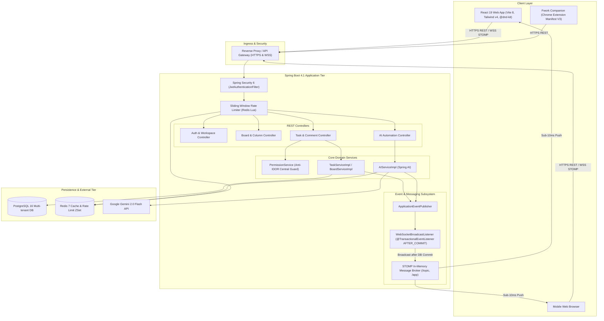
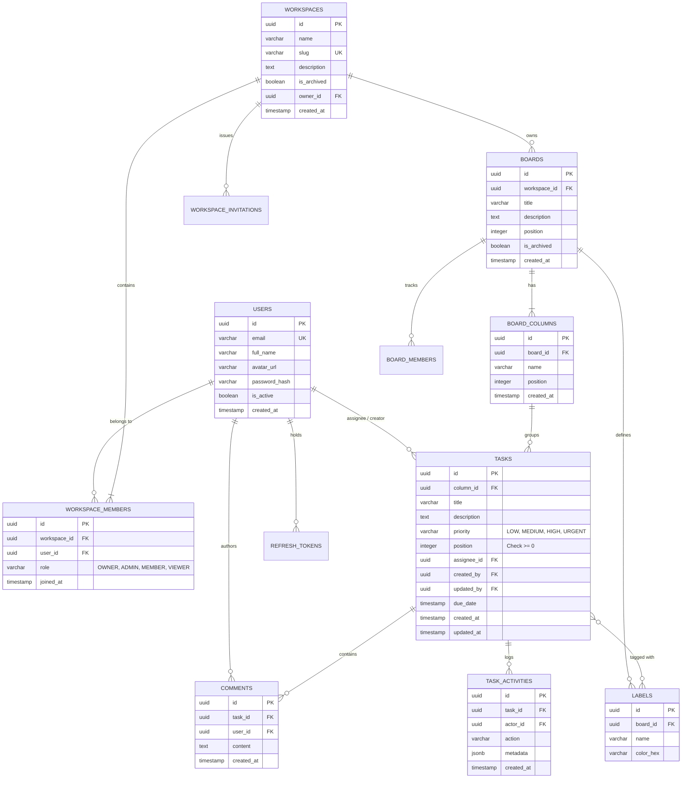
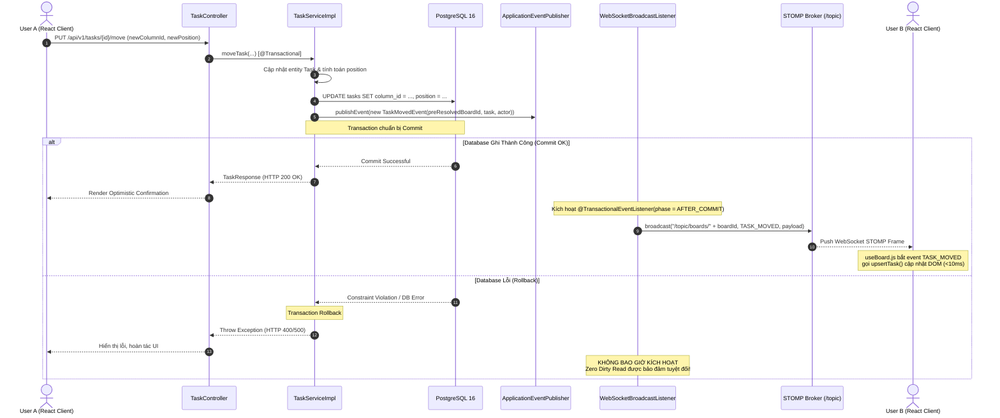
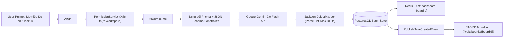

# TÀI LIỆU THIẾT KẾ KIẾN TRÚC HỆ THỐNG (SYSTEM DESIGN SPECIFICATION)
# DỰ ÁN: FWORK — ENTERPRISE REAL-TIME COLLABORATIVE KANBAN PLATFORM

---

## 1. TỔNG QUAN HỆ THỐNG & YÊU CẦU THIẾT KẾ (EXECUTIVE SUMMARY & REQUIREMENTS)

### 1.1. Giới thiệu dự án
**Fwork** là nền tảng quản lý dự án cộng tác và bảng Kanban thời gian thực (Real-time Enterprise Kanban Collaboration Platform) chuẩn SaaS. Hệ thống được thiết kế để giải quyết bài toán quản lý quy trình công việc đa người dùng với độ trễ thấp, đảm bảo tính toàn vẹn dữ liệu ở cấp độ doanh nghiệp, bảo mật phân quyền đa tầng và hỗ trợ trí tuệ nhân tạo (Generative AI) tự động hóa phân rã tác vụ.

### 1.2. Yêu cầu Chức năng (Functional Requirements - FR)
1. **Quản lý Tổ chức Đa tầng (Multi-tenancy Hierarchy)**:
   - Cấu trúc cây dữ liệu: `Workspace` (Không gian làm việc) $\rightarrow$ `Board` (Bảng dự án) $\rightarrow$ `BoardColumn` (Cột trạng thái) $\rightarrow$ `Task` (Thẻ công việc).
   - Quản lý nhãn dán (`Label`), bình luận (`Comment`), tệp đính kèm và lịch sử hoạt động (`TaskActivity`).
2. **Bảng Kanban Thời gian thực (Real-time Kanban Sync)**:
   - Kéo thả thẻ mượt mà giữa các cột và sắp xếp thứ tự trong cùng một cột.
   - Đồng bộ hóa trạng thái tức thì (Sub-10ms) cho toàn bộ thành viên đang mở cùng bảng mà không cần tải lại trang (Zero-Refresh).
3. **Phân quyền Doanh nghiệp (Enterprise RBAC)**:
   - 4 cấp độ vai trò: `OWNER`, `ADMIN`, `MEMBER`, `VIEWER`.
   - Cơ chế kiểm soát truy cập chống leo quyền ngang/dọc (Anti-IDOR).
4. **Trợ lý Trí tuệ Nhân tạo (Spring AI / Gemini 2.0 Integration)**:
   - Tự động sinh danh sách công việc từ mục tiêu tổng quát (`Task Generation`).
   - Phân rã công việc phức tạp thành checklist/subtasks hành động được (`Task Breakdown`).
   - Tổng hợp và phân tích sức khỏe chu kỳ làm việc (`Sprint Retrospective Summary`).
5. **Tiện ích Mở rộng Trình duyệt (Chrome Extension Companion)**:
   - Thu thập thông tin từ bất kỳ website nào (URL, Title, Highlight text) và tạo thẻ trực tiếp vào đúng Board/Column với 1 chạm.

### 1.3. Yêu cầu Phi Chức năng (Non-Functional Requirements - NFR)
1. **Độ trễ & Hiệu năng (Latency & Performance)**:
   - Thời gian truyền nhận tín hiệu WebSocket giữa các client dưới 10ms trong mạng nội bộ và dưới 50ms trên Cloud.
   - Loại bỏ hoàn toàn bẫy truy vấn N+1 của ORM/Hibernate, giữ số lượng query cho 1 lần tải toàn bộ Board phức tạp ở mức 1–2 SQL queries.
2. **Tính Nhất quán & An toàn Giao dịch (Transactional Consistency & Zero Dirty Reads)**:
   - Ngăn chặn triệt để hiện tượng broadcast WebSocket khi transaction DB bị rollback hoặc chưa commit thành công.
3. **Bảo mật & Kiểm soát Tần suất (Security & Rate Limiting)**:
   - Xác thực phi trạng thái (Stateless Authentication) qua JWT kết hợp cơ chế Refresh Token lưu tại Redis.
   - Thuật toán Sliding Window Rate Limiting dựa trên Redis Sorted Set + Lua Script nguyên tử nhằm bảo vệ hệ thống khỏi DDoS và lạm dụng API AI.
4. **Khả năng Mở rộng (Scalability & High Availability)**:
   - Backend thiết kế phi trạng thái (Stateless), dễ dàng scale ngang nhiều instance.
   - Sẵn sàng tích hợp External Message Broker (RabbitMQ / Redis PubSub) khi mở rộng phân tán.

---

## 2. KIẾN TRÚC TỔNG THỂ HỆ THỐNG (SYSTEM TOPOLOGY)

### 2.1. Sơ đồ Topo Tổng quan
Hệ thống Fwork bao gồm 3 tầng máy khách (Clients), 1 tầng dịch vụ nghiệp vụ (Core Services), và tầng lưu trữ/bộ nhớ đệm (Persistence & Cache):



### 2.2. Giao thức Truyền thông & Endpoint Channels
| Thành phần | Giao thức | Cổng / Đường dẫn | Mục đích |
| :--- | :--- | :--- | :--- |
| **REST API** | HTTPS | `/api/v1/*` | Thao tác CRUD dữ liệu, Auth, Upload, AI Trigger |
| **STOMP WebSocket**| WSS / SockJS | `/ws` | Kết nối socket thời gian thực có xác thực JWT |
| **STOMP Destination**| In-memory Pub/Sub| `/topic/boards/{boardId}` | Kênh phân phối sự kiện cho từng bảng Kanban |
| **Actuator Metrics** | HTTP | `/actuator/health`, `/actuator/metrics` | Giám sát tình trạng vận hành hệ thống |

---

## 3. THIẾT KẾ CƠ SỞ DỮ LIỆU & QUẢN LÝ DỮ LIỆU (DATA MODEL & SCHEMA)

### 3.1. Sơ đồ Quan hệ Thực thể (Entity Relationship Diagram - ERD)



### 3.2. Chiến lược Tối ưu hóa Database & Chống N+1 Query
1. **Dynamic `@EntityGraph` trên JPA Repositories**:
   - Khi người dùng mở một Board, hệ thống cần hiển thị toàn bộ Task, tên người phụ trách (Assignee), và danh sách Nhãn (Labels).
   - Fwork cấu hình `@EntityGraph(attributePaths = {"column", "createdBy", "updatedBy", "assignee", "labels"})` tại `TaskRepository.java`.
   - Kết quả: Spring Data JPA tự động sinh câu truy vấn `LEFT OUTER JOIN` gom toàn bộ dữ liệu chỉ trong **1 câu lệnh SQL duy nhất**, loại bỏ triệt để hàng trăm câu query con phát sinh theo cơ chế nạp lười (Lazy Loading).
2. **Batch Aggregate Queries**:
   - Tại `BoardRepository.java`, thay vì lặp qua từng Workspace để đếm số lượng Board (phát sinh N câu query `COUNT`), hệ thống sử dụng:
     ```sql
     SELECT b.workspace.id, COUNT(b)
     FROM Board b
     WHERE b.workspace.id IN :workspaceIds AND b.isArchived = false
     GROUP BY b.workspace.id
     ```
   - Gom toàn bộ việc kiểm đếm vào 1 truy vấn duy nhất.
3. **Database Check Constraints & Indexing**:
   - Ràng buộc vị trí: `@Check(constraints = "position >= 0")` bảo đảm thứ tự sắp xếp thẻ luôn hợp lệ.
   - Chỉ mục tối ưu: `idx_tasks_column_id`, `idx_tasks_assignee_id`, `idx_tasks_due_date` đảm bảo tốc độ lọc và sắp xếp luôn ở độ phức tạp $O(\log N)$.

---

## 4. HỆ THỐNG THỜI GIAN THỰC (REAL-TIME EVENT-DRIVEN STOMP SUBSYSTEM)

### 4.1. Bản chất luồng Transaction-Safe Broadcast
Một điểm quan trọng trong kiến trúc của Fwork là ngăn chặn triệt để hiện tượng **Dirty Read** (Dữ liệu gửi lên màn hình người khác trước khi thực sự được lưu vào database).



### 4.2. Xử lý Tránh Bẫy `LazyInitializationException` trên Thread Pool `@Async`
- `WebSocketBroadcastListener.java` được đánh dấu `@Async` để giải phóng thread xử lý HTTP chính ngay sau khi commit, giúp throughput của server không bị nghẽn bởi việc phát thanh WebSocket.
- **Rủi ro**: Khi chạy trên thread mới, Hibernate Session ban đầu đã đóng. Nếu listener cố gắng gọi `task.getColumn().getBoard().getId()`, ứng dụng sẽ văng `LazyInitializationException`.
- **Giải pháp**: Tất cả các sự kiện (`TaskCreatedEvent`, `TaskMovedEvent`, `TaskUpdatedEvent`) đều bắt buộc phải đóng gói sẵn giá trị `UUID boardId` nguyên thủy trước khi gửi vào Event Publisher.

---

## 5. BẢO MẬT PHÂN QUYỀN ĐA TẦNG & CHỐNG IDOR (SECURITY & ANTI-IDOR RBAC)

### 5.1. Mô hình Phân quyền Tập trung (Centralized Permission Matrix)
Thay vì phân tán logic kiểm tra quyền tại từng tầng Controller hay rải rác trong câu lệnh SQL, toàn bộ quy tắc phân quyền được quy tụ về [PermissionService.java](file:///d:/Fwork/backend/src/main/java/com/intern/fwork/services/PermissionService.java).

| Hành động | OWNER | ADMIN | MEMBER | VIEWER | Ghi chú |
| :--- | :---: | :---: | :---: | :---: | :--- |
| **Xóa / Đổi tên Workspace** | ✅ | ❌ | ❌ | ❌ | Chỉ chủ sở hữu cao nhất |
| **Mời / Xóa thành viên Workspace** | ✅ | ✅ | ❌ | ❌ | Quản trị viên cấp Workspace |
| **Tạo / Sửa / Xóa Board** | ✅ | ✅ | ❌ | ❌ | Thành viên thông thường không được tự ý xóa Board |
| **Tạo / Kéo thả / Sửa Task** | ✅ | ✅ | ✅ | ❌ | Quyền tác vụ thường nhật |
| **Tạo Bình luận (Comment)** | ✅ | ✅ | ✅ | ❌ | Tương tác nội bộ |
| **Xem bảng & Xem công việc** | ✅ | ✅ | ✅ | ✅ | Chỉ đọc (Read-only) |

### 5.2. Cơ chế Triệt tiêu Lỗ hổng IDOR (Insecure Direct Object Reference)
Mọi ID truyền lên từ Client (`boardId`, `columnId`, `taskId`, `commentId`) đều bị coi là **không đáng tin cậy**. Quy trình thẩm định luôn truy ngược về Workspace:

$$\text{Target ID} \xrightarrow{\text{Tra cứu DB}} \text{Task} \xrightarrow{\text{column}} \text{BoardColumn} \xrightarrow{\text{board}} \text{Board} \xrightarrow{\text{workspace}} \text{WorkspaceID}$$

Sau đó, hệ thống đối chiếu với bảng `workspace_members`:
- User hiện tại có nằm trong Workspace này không?
- Vai trò hiện tại của User (`role`) có đủ quyền cho hành động đó không?
- Nếu không thỏa mãn $\rightarrow$ Lập tức ngắt luồng và ném `AccessDeniedException` (HTTP 403 Forbidden).

### 5.3. Sliding Window Rate Limiter bằng Redis & Lua Script
Để bảo vệ tài nguyên tính toán và ngăn chặn tấn công từ chối dịch vụ hoặc brute-force:
* **Thuật toán Cửa sổ Trượt (Sliding Window)**: Khắc phục nhược điểm của Fixed Window (vốn dễ bị vượt ngưỡng gấp đôi ở ranh giới giữa 2 cửa sổ).
* **Đảm bảo Tính nguyên tử (Atomicity) bằng Lua**:
  ```lua
  redis.call('ZREMRANGEBYSCORE', KEYS[1], '-inf', ARGV[2])
  local count = redis.call('ZCARD', KEYS[1])
  if count >= tonumber(ARGV[3]) then
      return 0
  end
  redis.call('ZADD', KEYS[1], ARGV[1], ARGV[4])
  redis.call('PEXPIRE', KEYS[1], ARGV[5])
  return 1
  ```
* **Cơ chế Tự phục hồi Circuit Breaker**: Nếu kết nối tới Redis bị gián đoạn, `RedisRateLimiter.java` tự động kích hoạt fallback sang `InMemoryRateLimiter` nội bộ trong vòng 30 giây, giúp hệ thống không bao giờ bị "chết chùm" vì sự cố hạ tầng cache.

---

## 6. HỆ THỐNG TRÍ TUỆ NHÂN TẠO (AI DECOMPOSITION ENGINE)

### 6.1. Kiến trúc Tích hợp Spring AI & Gemini 2.0
Fwork sử dụng `org.springframework.ai.chat.model.ChatModel` kết nối trực tiếp với mô hình **Google Gemini 2.0 Flash**.



### 6.2. Các Trường hợp Sử dụng Cốt lõi (Use Cases)
1. **`generateTasks(boardId, goal, count, columnId)`**:
   - Chuyển đổi một câu lệnh tự nhiên (ví dụ: *"Xây dựng luồng thanh toán Stripe chuẩn PCI-DSS"*) thành danh sách 5–10 thẻ công việc hoàn chỉnh kèm mô tả kỹ thuật, độ ưu tiên (`URGENT`, `HIGH`, `MEDIUM`, `LOW`), hạn chót tương đối và số thứ tự sắp xếp.
2. **`breakdownTask(boardId, taskId)`**:
   - Phân rã một tác vụ phức tạp thành danh sách hành động cụ thể (Actionable Checklist) gồm 3–7 mục nhỏ, giảm thiểu rào cản nhận thức cho lập trình viên.
3. **`getSprintSummary(boardId)`**:
   - Thu thập toàn bộ số liệu thống kê của Board (Tỷ lệ hoàn thành, số task nghẽn ở In Progress, số task quá hạn) để tạo bản tổng hợp báo cáo Sprint Retrospective theo phong cách chuyên nghiệp.

### 6.3. Tự động Đồng bộ hóa & Dọn dẹp Cache
Sau khi AI hoàn tất việc sinh thẻ và lưu DB:
- Hệ thống gọi `cacheManager.getCache("dashboard").evict(boardId)` để xóa sạch dữ liệu cache cũ trên Redis.
- Bắn sự kiện `TaskCreatedEvent` qua STOMP. Màn hình Kanban của toàn bộ nhóm lập tức xuất hiện các thẻ mới được sinh ra một cách mượt mà.

---

## 7. KIẾN TRÚC CLIENT: FRONTEND WEB & CHROME EXTENSION

### 7.1. Frontend Web App (React 19 & @dnd-kit)
- **Công nghệ**: React 19.2, Vite 8, Tailwind v4, `@dnd-kit/core`, `@dnd-kit/sortable`, `@stomp/stompjs`.
- **Cơ chế Cập nhật Lạc quan (Optimistic UI Updates)**:
  - Khi người dùng kéo thẻ từ Cột A sang Cột B, giao diện lập tức dời thẻ trên DOM trước khi nhận phản hồi từ server.
  - Đồng thời, gửi HTTP PUT API ngầm. Nếu server phản hồi lỗi (hoặc rollback), hook `useBoard.js` sẽ hoàn tác thẻ về vị trí cũ và hiển thị thông báo lỗi.
- **Chuẩn hóa Dữ liệu Linh hoạt (Data Normalization)**:
  - Khắc phục xung đột đặt tên giữa Backend (camelCase) và Database/SnakeCase (`column_id` vs `columnId`, `due_date` vs `dueDate`) qua các hàm chuẩn hóa `normalizeTask()` và `normalizeColumn()`.

### 7.2. Fwork Companion (Chrome Extension Manifest V3)
- **Công nghệ**: React 19, TypeScript, Manifest V3.
- **Quyền hạn tối thiểu (Least Privilege)**:
  - `activeTab`: Chỉ đọc dữ liệu của tab người dùng đang chủ động xem khi nhấn vào icon extension.
  - `storage`: Lưu token JWT an toàn tại `chrome.storage.local`.
  - `identity`: Hỗ trợ đăng nhập 1 chạm qua Google OAuth.
- **Luồng hoạt động Web Clipper**:
  ```
  User nhấn Icon Extension trên bất kỳ trang web nào (VD: GitHub Issue)
            │
            ▼
  Popup đọc: tab.title ➔ Task Title | tab.url + selectedText ➔ Task Description
            │
            ▼
  User chọn Workspace ➔ Board ➔ Cột đích ➔ Bấm "Lưu Thẻ"
            │
            ▼
  Gọi REST API POST /api/v1/tasks với Bearer JWT
            │
            ▼
  Backend Spring Boot lưu DB & phát sóng STOMP ➔ Thẻ mới hiện trên Web App tức thì!
  ```

---

## 8. HẠ TẦNG TRIỂN KHAI, MỞ RỘNG & ĐẢM BẢO HOẠT ĐỘNG (DEPLOYMENT & SCALABILITY)

### 8.1. Cấu hình Vận hành Docker Compose
Hệ thống được đóng gói sẵn sàng cho môi trường Production / Staging qua `docker-compose.yml`:
- **`fwork-db`**: PostgreSQL 15/16 Alpine với volume mount `pgdata`, cấu hình kiểm tra sức khỏe tự động (`pg_isready`).
- **`fwork-redis`**: Redis 7 Alpine với volume mount `redisdata`, quản lý Rate Limit & Session Caching.
- **`fwork-backend`**: Ứng dụng Spring Boot 4.1 chạy trên JDK 21 Alpine, phụ thuộc vào tình trạng `service_healthy` của DB và Redis.
- **`fwork-frontend`**: Image Nginx phục vụ Single Page Application (SPA) trên cổng 80/3000.

### 8.2. Chiến lược Mở rộng Ngang khi Tăng trưởng (Horizontal Scale Roadmap)
1. **Mở rộng STOMP Broker Phân tán**:
   - Hiện tại hệ thống dùng Simple In-Memory Broker của Spring.
   - Khi chạy nhiều instance Spring Boot đằng sau Load Balancer, các instance cần chia sẻ trạng thái WebSocket. Fwork thiết kế sẵn sàng để chuyển sang **RabbitMQ Stomp Relay** hoặc **Redis Pub/Sub** chỉ qua cấu hình properties mà không cần sửa đổi code domain.
2. **Cơ sở Dữ liệu Đọc/Ghi Phân tách (Read/Write Replicas)**:
   - Tách biệt luồng ghi (Tasks manipulation, AI batch creation) vào Primary DB và luồng đọc (Fetch toàn bộ board, view audit logs) vào Read-Only Replicas sử dụng PgBouncer / HikariCP.
3. **Giám sát & Quan sát Toàn diện (Observability)**:
   - Tích hợp Spring Boot Actuator để báo cáo trạng thái RAM, GC, Thread count và Database Connection Pool.
   - Bảng `audit_logs` ghi nhận đầy đủ mọi hoạt động thay đổi quyền hạn, xóa workspace, bảo đảm tiêu chuẩn an toàn thông tin doanh nghiệp.

---

*Tài liệu này được xác lập làm chuẩn kiến trúc kỹ thuật (System Design Blueprint) của nền tảng Fwork.*
